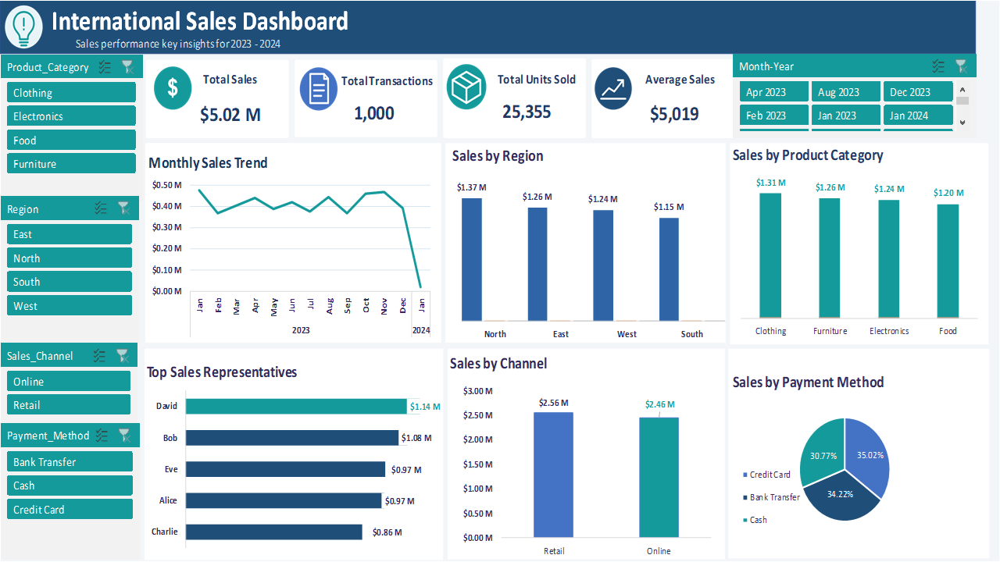

# International Sales Dashboard

An interactive Excel dashboard analysing 1,000 sales transactions (Jan 2023 to Jan 2024) from a sample dataset.

## Key Results
- Total Sales: $5.02M
- Total Transactions: 1,000
- Total Units Sold: 25,355
- Average Sale: $5,019

## Insights
- North is the top region ($1.37M); South is the lowest ($1.15M)
- Clothing leads categories ($1.31M), but all four are within about 9%
- David is the top rep ($1.14M), followed by Bob ($1.08M)
- Retail leads Online by about 4%
- Payments: Credit Card 35%, Bank Transfer 34%, Cash 31%

## Data Notes
- Jan 2024 contains only one day of data (about $19K), so it is a partial month, not a real sales drop.
- Sales_Amount is used as given in the source data. Profit was not analysed because Sales_Amount does not reconcile with quantity x price.
- No blanks or duplicates were found in the data.

## Tools Used
Excel: data cleaning, pivot tables, slicers, charts, dashboard design

## Files
- `International_Sales_Dashboard.xlsx`: full workbook
- `dashboard.png`: dashboard preview
